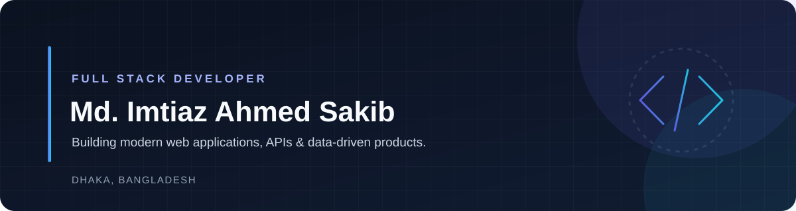

  

  
  
  

  <strong>Full Stack Developer</strong> · Dhaka, Bangladesh

I build modern web applications with thoughtful frontend experiences, reliable APIs, and structured data layers. My work spans React-based interfaces, TypeScript applications, backend services, and database-driven features.

---

## About

I'm a Full Stack Developer interested in building practical, maintainable software from the user interface through to the API and database.

I enjoy working across the application stack: shaping responsive interfaces, implementing RESTful APIs, modelling data, and connecting the pieces into cohesive products. I value clear code, understandable architecture, and solutions grounded in real user workflows.

## Tech Stack

My proficiency is grouped transparently below. These labels describe my current working comfort, not measured percentages.

### Expertise

  
  
  
  
  
  
  
  
  

`TypeScript` · `JavaScript` · `React` · `Redux` · `React Router` · `Tailwind CSS` · `JWT` · `shadcn/ui` · `Next.js`

### Comfortable

  
  
  
  
  
  
  

`Node.js` · `Express.js` · `PostgreSQL` · `Prisma` · `MongoDB` · `Mongoose` · `NestJS`

### Familiar

  
  

`Bootstrap` · `Docker`

### Development Tools

  
  
  
  
  

`VS Code` · `Postman` · `GitHub` · `Figma` · `npm`

## Featured Projects

A selection of web applications I've built, with links to the live products and source code.

### 01 — Talentra

**A talent hunting and recruitment management application** that connects companies with potential candidates.

- Candidate discovery, filtering, and detailed profiles
- Company and candidate accounts
- Interest requests with accept/decline workflows
- Role-based access for Admin, Company, and Candidate

**Stack:** TypeScript · React · Redux · React Router · Express.js · PostgreSQL · Prisma · JWT

  
  
  

### 02 — RideEasy

**A bike rental platform** for browsing bikes, managing rentals, and handling inventory.

- Bike browsing and search
- Bike rental functionality and rental management
- Inventory management
- User and admin management
- Payment-related functionality

**Stack:** TypeScript · React · Redux · React Router · Tailwind CSS · Express.js · Mongoose · JWT

  
  
  

### 03 — NexTechy

**A technology blogging platform** where readers can discover articles, save posts, and join discussions.

- Blog browsing and search by title or category
- Blog detail pages
- Wishlist functionality
- Comments and discussions

**Stack:** React · React Router · JavaScript · Tailwind CSS · Firebase · Express.js · MongoDB

  
  
  

### 04 — Movie Review Web App

A movie review web application built with a modern Next.js and data-access stack.

**Stack:** Next.js · TanStack Query · PostgreSQL · Prisma

_Repository and live demo links have not been provided._

## Development Focus

- Building full-stack web applications with TypeScript
- Developing frontend experiences with React and Next.js
- Designing and implementing backend APIs
- Working with PostgreSQL, Prisma, and data modelling
- Improving maintainability through clear architecture and code organization

## Connect

I'm open to connecting with developers, discussing projects, and exploring collaboration opportunities.

  
  
  

---

  Thanks for visiting my profile.

